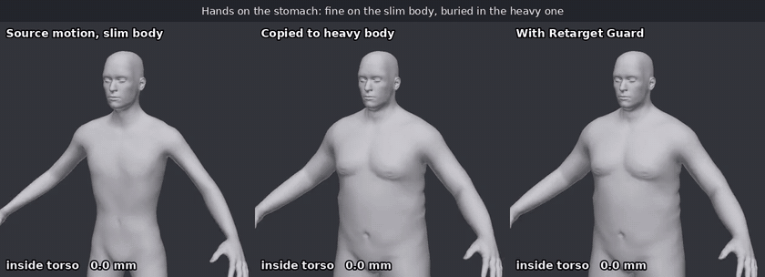

# Retarget Guard

Put a motion on a body it was not made for and the hands go into the stomach.
Retarget Guard is a small module that sits after a real-time motion model and
removes that penetration on the final skin, without retraining the model and
without changing how the motion reads.



The red areas are the parts of the hand and forearm inside the torso, and the
labels give the deepest vertex. [Full video](media/demo.mp4). Regenerate it with
`tools/render_demo.py`.

- **Plug-in.** The motion model stays a black box. You add one call per frame.
- **No training.** Each character needs one pack, built once from its mesh, skin
  weights and skeleton. That includes the character the model was made for.
- **Fast.** Plain C on one CPU core, at a sub-frame cost.
- **Repairs the model too.** Penetration already in the model's output is
  corrected, not passed through.
- **Exact when clean.** A frame with nothing to fix and no correction in progress
  comes back bit-identical to the input.

## How it works

Layer 1 runs before skinning. It solves a vertex-level QP in plain
single-threaded C and returns corrected local joint rotations, which removes
deep conflicts. Layer 2 runs after the host skins the character. It compresses
soft tissue where surfaces still touch, statelessly and within a budget, so
shallow contact stays a contact and the arm is not lifted away from the body.

## Results

Measured on 320 clips that were never used for tuning, on three body shapes,
for 960 clip and body pairs. Depth is raw: it is measured on the final skin with
no allowance for soft tissue, by an independent solid test (winding number on a
capped torso mesh, then exact point-to-triangle distance). The final columns
cover all 288,000 frames. Copied rates use every 15th frame, and copied maxima
add the deepest frames flagged by a surface scan.

| Region | Frames beyond 20 mm, copied | Final | Deepest, copied | Final |
|---|---:|---:|---:|---:|
| Hand into torso | 15.53 % | 0.00 % | 135.6 mm | 9.3 mm |
| Forearm into torso | 10.41 % | 0.00 % | 90.3 mm | 5.3 mm |
| Upper arm into torso | 39.79 % | 0.11 % | 58.5 mm | 27.1 mm |

The upper arm is left to soft tissue on purpose, because forcing the armpit apart
lifts the whole arm. 10.24 % of final frames stay beyond 10 mm there.

The motion keeps its character. Median high-frequency joint energy is 1.008
times that of the copied motion (90th percentile 1.079), wrists move 0.85 cm on
average, and intended contacts are kept at 0.953 against 0.976 for the copy. On
a very heavy body the wrists have to move further: 5.11 cm on average.

| Cost on one pinned CPU core | Mean | P99 |
|---|---:|---:|
| Layer 1, no lookahead | 0.75 ms | |
| Layer 1, 5 frames of lookahead | 1.11 ms | 1.66 ms |
| Layer 2, 6,890 vertices | 1.18 ms | 1.80 ms |

Measured on an AMD EPYC 7K62 with other jobs on the machine. P99 is the largest
value across the test groups. The two means add up to 2.29 ms per frame, measured
separately and excluding host skinning and interface overhead. Lookahead also
adds its own buffering delay, 167 ms for 5 frames at 30 fps.

The video above, deepest vertex in mm:

| Case | Source | Copied | With Retarget Guard |
|---|---:|---:|---:|
| Hands on the stomach | 0.0 | 36.0 | 1.7 |
| Arms crossed | 15.3 | 72.5 | 0.0 |
| Source already penetrates | 94.2 | 142.3 | 3.0 |

The SMPL-H evaluation data cannot be redistributed, so these numbers cannot be
reproduced from this repository alone. The demo above can.

Not validated so far: Windows and macOS, real garments, and integration inside a
game engine. The method gives no guarantee of removing every overlap. Deep or
impossible poses can keep a residual.

## Install

```sh
python -m pip install .
python examples/quickstart.py
```

The example prints the depth before and after. It takes about a minute, nearly
all of it in the Python depth diagnostic rather than the module. Building a
character pack took about 0.2 s here for a 13,380-vertex body.

Python 3.10+, NumPy and a C99 compiler named `cc` are required. There is no
Torch, BLAS or SciPy dependency in this package. The three C libraries compile
on first use into the user cache. Installation itself does not need a compiler.

The default numerical options are `-std=c99 -O3 -fno-math-errno
-ffp-contract=fast -fPIC -shared` for Layer 1. Layer 2 uses the
same options without the explicit `-ffp-contract` option. These retain the
original solver's math options. `CC`, `CFLAGS`, `TMPDIR`,
`RETARGET_GUARD_CACHE` and `RETARGET_GUARD_MARCH` are honored. To build for
another architecture, set `RETARGET_GUARD_MARCH` appropriately. The default
omits `-march` for portability, including older compilers. For the original
reference options, use `CC=clang RETARGET_GUARD_MARCH=x86-64-v3`. After
changing compiler options, rebuild explicitly:

```sh
CC=clang RETARGET_GUARD_MARCH=native python -m retarget_guard._build
```

The cache uses timestamps and atomic replacement, without fingerprints or
version gates. Set a separate cache directory when comparing compiler options.
Only Linux with Clang and GCC has been exercised. The current shared-library
loader/build helper targets POSIX systems; Windows is not supported.

## Ten-line usage

This self-contained example uses the bundled CC0 MPFB assets. The sample input
is already expressed in each character's local bind-delta convention.

```python
from retarget_guard import RetargetGuard, vertex_normals
from retarget_guard.demo import demo_character, procedural_motion
source, target = demo_character("source"), demo_character("target")
motion = procedural_motion(source)
with RetargetGuard(target, source, lookahead=0, fps=30) as guard:
    for pose in motion:
        corrected = guard.step(pose, source_pose=pose)
        vertices = target.skin(corrected)  # Or the host's skinning implementation.
        normals = vertex_normals(vertices, target.data["mesh_faces"])
        vertices = guard.deform(vertices, normals)
```

## Build a character

```python
from retarget_guard import build_character, SEMANTICS
character = build_character(
    vertices, faces, skin_weights, joint_parents, rest_joints,
    semantic_map=dict(zip(SEMANTICS, body_joint_indices)),
    rest_basis=world_bind_rotations,  # Optional; defaults to identity.
    output="my_character.npz",
)
```

Inputs use right-handed Y-up coordinates in **metres**, outward triangle
winding, dense skin weights `[V,J]`, triangular faces `[F,3]`, rest joint
positions `[J,3]`, and a parent-before-child hierarchy `[J]` with root parents
`-1`. Skeletons may have 22–128 joints. The 22 distinct anatomical mappings,
in order, are:

```text
pelvis l_hip r_hip spine1 l_knee r_knee spine2 l_ankle r_ankle
spine3 l_foot r_foot neck l_collar r_collar head l_shoulder
r_shoulder l_elbow r_elbow l_wrist r_wrist
```

`semantic_map` may be this list of indices or a dictionary with those names.
Extra bones, including fingers, inherit the part of their nearest mapped
ancestor. `bone_parts=[J]` can override the derived part labels when a rig uses
unusual auxiliary bones. Labels 0–13 follow `retarget_guard.PARTS`.

The builder derives part membership from dense skin weights, computes
area-weighted vertex normals and soft thickness from distances to the mapped
anatomical bone segments, then selects query/collider surfaces with the original
farthest-point sampling and four strongest skin influences. No manual part
labels or thickness estimates are required. The humanoid mesh must contain
high-purity surfaces for all body regions; missing regions raise a descriptive
error. This does not reconstruct body skin beneath clothes-only assets.

Individual nonfinite/unweighted vertices and invalid faces are skipped with a
warning and recorded as `dropped_vertices` and `dropped_faces`. More than 1%
invalid vertices or lost faces raises an error; `max_bad_fraction` is explicit.
Invalid skeletons, semantics or configuration raise immediately.

Packs retain the full cleaned mesh for Layer 2 as well as sampled solver data.
`Character.load(path)` reads saved packs without pickle. Older sampled-only
research packs can be used for Layer 1, but must be rebuilt for Layer 2. When
bad vertices are removed, the host must use the cleaned pack topology for
`deform`; `vertex_ids` maps sampled vertices to the original input indices.

## Use a user-owned SMPL-H model

```python
from retarget_guard import from_smplh, RetargetGuard
target = from_smplh("my_smplh_model.npz", target_betas, output="target.npz")
source = from_smplh("my_smplh_model.npz", model_original_betas)
guard = RetargetGuard(target, source, lookahead=0)
corrected_pose = guard.step(local_pose)  # [52,3] or [52,3,3].
guard.close()
```

Supply your own licensed numeric NPZ containing `v_template`, `shapedirs`, a
dense `J_regressor`, `weights`, `f` (or `faces`), and `kintree_table` for 52
joints. The beta length must match `shapedirs.shape[-1]`. Pickled model objects
and sparse regressors stored as object arrays are not loaded. The helper uses
shape blendshapes and LBS; it does not evaluate SMPL pose blendshapes. Supply
the host's final posed mesh to `deform` when using a richer body model.

No SMPL/SMPL-H/SMPL-X files, templates, packs or motions are distributed here.
The reference parity audit reads user-supplied research data externally.

## Streaming API and latency

```python
RetargetGuard(target, source, lookahead=0, fps=30, *, kappa=None, settings=None)
guard.step(pose, *, source_pose=None)  # corrected pose or None during buffering
guard.flush()                        # iterator over remaining corrected poses
guard.deform(vertices, normals)      # corrected vertices, not displacement
guard.close()                        # also supported by a with block
```

`target` and `source` are `Character` objects or pack filenames. `pose` is one
frame of axis-angle rotations `[J,3]` or rotation matrices `[J,3,3]` in radians.
Output has the same representation and joint ordering, in float64. Rotations
are local deltas **after the local bind rotation**. Identity reproduces rest.
On the 21 mapped body joints, `R_out = R_in @ Exp(delta)`. Root, fingers and
other unmapped joints retain their inputs. Unchanged axis-angle joints retain
their original values even outside the principal rotation-vector branch.

The module corrects an upstream retargeted target pose. For different skeletons
or bind frames, pass the original model frame as `source_pose` and the host's
retargeted target frame as `pose`. When both skeletons and bind conventions
agree, omitting `source_pose` uses the same input for both packs. Rest positions
and body shapes may differ. The wrapper does not infer a motion retarget map.

Lookahead is any integer from 0 to 5. The first L calls return `None`; each later
call returns the oldest buffered frame. Latency is L/fps seconds (167 ms for
L=5 at 30 fps). Inputs are copied into a bounded queue, so the caller can reuse
its buffers. Iterate `flush()` to emit every remaining frame using shorter
future windows. Flushing ends the clip; use a fresh instance for a new clip.

`last_delta` is `[21,3]` in semantic body order, and `last_stats` is the C
diagnostic array for the latest output. Inspect them immediately after each
step/flush output. Any nonzero C return raises; a failed Layer 1 stream cannot
continue. Invalid input/configuration and nonfinite results also raise.
Use one instance per stream/thread. Close it after the host has consumed all
outputs.

`settings.json` is a verbatim copy of the frozen research settings (**h13**),
including its historical records. `frozen_settings(**overrides)` loads its
`settings` object; the default streaming wrapper uses that configuration with
the requested fps. `Settings()` itself retains the original research defaults;
use `frozen_settings()` when making explicit h13 overrides.

## Layer 1 and Layer 2

Layer 1 changes joint rotations before host skinning. The sampled mesh QP
balances contact, penetration, joint limits and temporal smoothness. It has
state and can still leave residual intersections in deep or impossible poses.

Layer 2 takes the host's final skinned `[V,3]` vertices and outward unit normals
on the full cleaned body topology. It returns float32 vertices with bounded
local contact compression. It is stateless with respect to frame history;
recompute normals after deformation for rendering. It addresses soft contact
within its tissue budget and does not guarantee elimination of arbitrary deep
overlap. `last_deform_stats` holds the latest C diagnostics.

`Character.skin()` is a simple NumPy LBS reference for integration/examples;
production hosts can use their existing skinning pipeline.

## Cloth

Pass nonnegative `cloth_offset=[V]` in metres to `build_character`, then use
`RetargetGuard(..., kappa=0.5)`. Offsets describe garment distance above each
body vertex and must be supplied by the host's offline garment processing.
`kappa=0` treats the garment surface as hard; `kappa=1` permits full garment
compression to the body and reproduces the body-only solver. The optional
cloth kernel lifts arm-to-torso and arm-to-leg contact surfaces. Without a
cloth offset field it uses zero offsets. Kappa controls Layer 1; Layer 2 acts
on the body skin and does not skin or deform a separate garment mesh.

## Demo assets and procedural motion

`examples/quickstart.py` builds a slim source and a heavy target using only
bundled mesh, weights and skeleton data, then generates a short bilateral
motion with both hands on the stomach. It measures copied, Layer 1 and combined
results on the full mesh. `--output example.npz` saves procedural poses and diagnostics;
`--lookahead 0..5` changes the streaming horizon.

The bodies were generated with MPFB. The base mesh, targets and rig assets are
**CC0 1.0**; MPFB's official license separately identifies program code as
GPLv3 and permits generated model output. Only numeric body assets are bundled.
See [asset provenance](src/retarget_guard/data/PROVENANCE.md), the included CC0
dedication, and the [official license](https://github.com/makehumancommunity/mpfb2/blob/master/LICENSE.md).
No MPFB program code, garments, model output from other research systems,
recorded motion, or third-party reference implementation is included.

## Validation

```sh
python -m pip install '.[test]'
python -m pytest -q
python tools/verify_research.py --research-root PATH_TO_RESEARCH_CHECKOUT
```

The optional research audit needs the original research dependencies and
licensed local data. It compiles the reference C file in this release directory,
never invokes the protected research build, and saves only numeric difference
reports. See [verification report](verification/REPORT.md) for measured parity,
field-by-field pack differences, test output and validation limits.

## Citation and license

The code is MIT licensed, see [LICENSE](LICENSE). The bundled demo bodies are
CC0. A technical report is in preparation.
